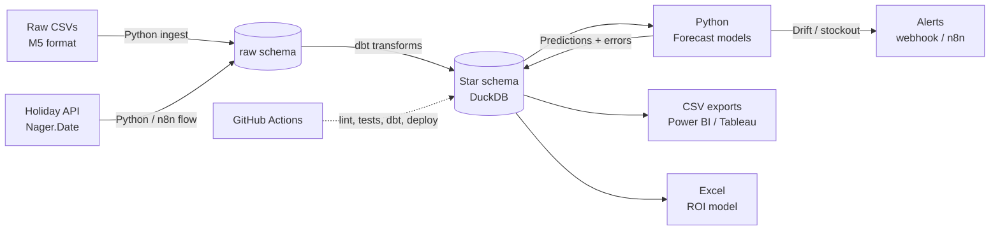
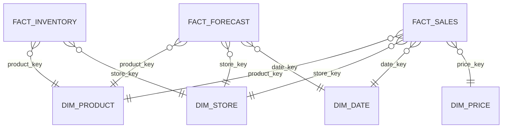
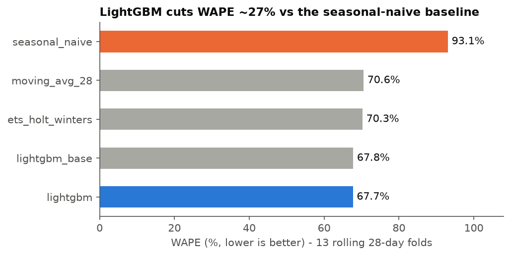
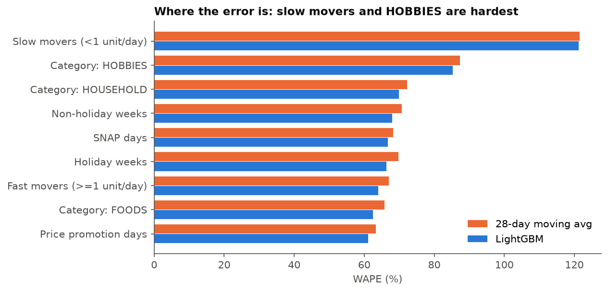
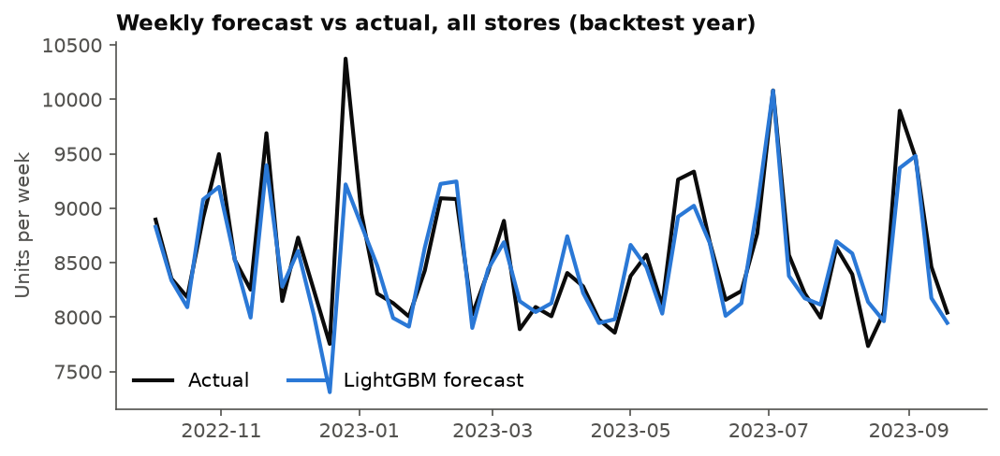
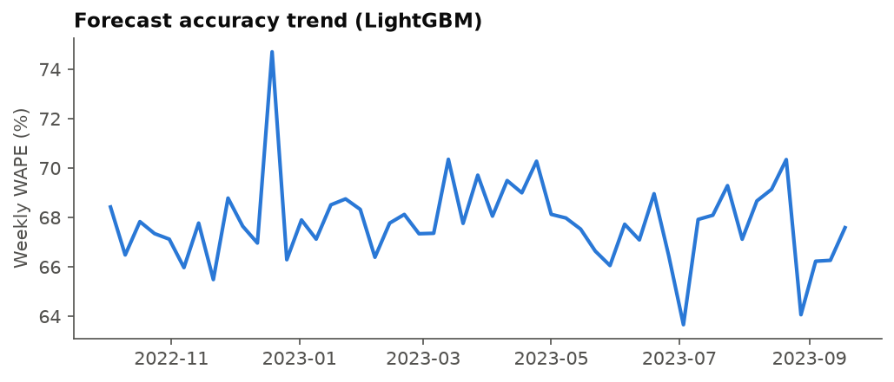

# 📦 Retail Demand Forecasting & Inventory ROI Platform

> An end-to-end analytics project that ingests retail sales data, models it in a dimensional data warehouse, forecasts product demand, dissects where the forecast fails, and translates accuracy into a dollar-value business case.


> **Read this first - what is real and what is synthetic.** The M5 data needs a Kaggle login, so the repo ships a generator (`src/ingest/generate_sample.py`) that writes data in the **exact M5 file format** (560 item-store series, 1,000 days, with known holiday/SNAP/promo effects). Every number below comes from that synthetic sample, and the same pipeline runs unchanged on the real M5 download. Stock-on-hand is also **simulated** (M5 has no inventory data). Power BI / Tableau files are not included: the repo produces the BI-ready exports and a build guide.

---

## 🔑 Key Results (TL;DR)

| Metric | Result |
|---|---|
| Forecast accuracy improvement vs. naive baseline | **27% lower WAPE** (67.7% vs 93.1%); 4% vs 28-day moving average; wins 13/13 backtest folds |
| Largest source of forecast error | **FOODS: 56% of total absolute error** (largest category); hardest per-unit: slow movers (WAPE 121%) and HOBBIES (85%) |
| Projected annual inventory savings | **~$530** expected on the 560-series sample (range $354-$701, ≈ $0.95/series/yr) |
| Records modelled in warehouse | **0.56 M** sales facts + **1.02 M** forecast rows (sample) |
| Data quality tests automated | **40 dbt tests** (+ 18 pytest unit tests) |

📄 [Executive summary](docs/executive_summary.md) · 🧭 [Dashboard build guide](docs/dashboard_build_guide.md) · 📓 [Notebooks](notebooks/)

---

## 🎯 Business Problem

Retailers lose money in two directions: **overstocking** ties up cash, **understocking** loses sales. Both come from inaccurate demand forecasts. This project answers:

1. **How much will each product sell over the next 28 days?**
2. **Where and why is the forecast wrong?**
3. **What is better forecasting actually worth in dollars?**

**Dataset:** [M5 Forecasting – Walmart](https://www.kaggle.com/competitions/m5-forecasting-accuracy/data) (30k products, 10 stores, 3 states) - or the bundled M5-format synthetic sample.

---

## 🏗 Architecture



**Flow:** Extract → Load raw → Transform in-warehouse (ELT) → Model → Write predictions back → Report → Alert

---

## 🛠 Tech Stack

| Layer | Tools |
|---|---|
| Ingestion | Python (pandas, DuckDB, requests), n8n flow exports |
| Warehouse | **DuckDB** (zero-setup; dbt profile is swappable for PostgreSQL/Snowflake) |
| Transformation | dbt Core (dbt-duckdb), SQL |
| Modelling | Python - statsmodels (Holt-Winters ETS), LightGBM, scikit-learn |
| Analysis | pandas, NumPy, SciPy, matplotlib |
| Reporting | CSV exports + static charts (Power BI / Tableau build guide), Excel (openpyxl, live formulas) |
| CI/CD | Git, GitHub Actions |
| Code Quality | ruff, pytest, sqlfluff |

---

## 🗂 Data Model

Star schema built with dbt (`dbt_project/models/marts`):



- `staging/` - 1:1 cleaning/casting (views)
- `intermediate/` - `int_sales_long` unpivots the wide `d_1..d_N` table **in SQL**, joins calendar and price, drops pre-launch rows
- `marts/` - `fact_sales`, `fact_inventory` (simulated), `dim_date`, `dim_product`, `dim_store`, `dim_price` (`price_band`: promo/regular/premium vs the item-store median)
- `fact_forecast` is written by Python (`src/models/train.py`) with an orphan-key integrity check; columns: date/product/store keys, `model_name`, `fold`, `horizon_day`, `forecast_units`, `actual_units`, `abs_error`

**Tests (40 + 4 singular):** `unique`, `not_null`, `relationships`, `accepted_values`, plus custom: no negative sales, every sale has a valid price, fact grain is unique, no zero-sales days except Dec 25.

---

## 📈 Forecasting Approach

13 rolling 28-day folds (one full year, so every holiday is backtested), trained only on data before each cutoff - no random splits. 1.02 M predictions.

| Model | Purpose | WAPE | Bias |
|---|---|---|---|
| Seasonal Naive (last week repeated) | Baseline to beat | 93.1% | +1.2% |
| Moving Average (28-day) | Simple benchmark | 70.6% | -0.1% |
| ETS Holt-Winters (weekly seasonality) | Classical statistical model | 70.3% | +0.2% |
| LightGBM (no event-lead features) | Ablation | 67.8% | -0.6% |
| **LightGBM (final)** | **Final model** | **67.7%** | -0.7% |

WAPE is high in absolute terms because item-store-day sales are low-count and noisy (as in real M5); the comparison between models is what matters.

**Features:** demand lags 28/35/42/364, rolling mean (7/28/56) and std, price, price ratio vs 91-day median, 7-day price change, weekday/month/day-of-month, SNAP and holiday flags, days-to-/since-event, store/item/department/category codes.

**Leakage control (deviation from the usual 7/14-day lags):** a single direct model forecasts all 28 days, so every demand-derived feature is shifted ≥ 28 days; price/calendar/event features are known in advance. A unit test perturbs demand at day *t* and asserts no feature changes for days *t..t+27*.

**Not implemented:** Prophet (heavy dependency, ETS used as the classical statistical benchmark).

---

## 🔍 Model Error Analysis

**Metrics:** WAPE, bias (signed error / actuals), MAE, residual autocorrelation.

### Error sliced by segment (final LightGBM)

| Segment | WAPE | Bias | Share of rows | Share of error | Insight |
|---|---|---|---|---|---|
| Category: FOODS | 62.5% | -0.6% | 43% | 56% | Best WAPE but biggest error pool |
| Category: HOBBIES | 85.3% | -0.9% | 29% | 18% | Low volume → noisiest |
| Category: HOUSEHOLD | 70.0% | -0.8% | 29% | 26% | |
| Holiday weeks | 66.3% | -2.7% | 17% | 19% | Mild under-forecast remains |
| Slow movers (<1 unit/day) | **121.2%** | +3.3% | 31% | 12% | Point forecast is worse than useless on WAPE; intermittent demand |
| Price promotion days | 61.2% | -1.7% | 8% | 11% | Price features work |
| SNAP days | 66.8% | -0.2% | 33% | 35% | Well captured |

### Key findings

1. **Slow movers are 31% of series but only 12% of error** and have WAPE > 100% (65% of their days are zero). Better handled by Croston/probabilistic methods and stocked by service-level policy.
2. **The baseline systematically misses events:** seasonal-naive under-forecasts holiday weeks by 12.5% and promo days by 33%; LightGBM brings these to -2.7% and -1.7%.
3. **Residuals show no remaining weekly pattern:** lag-7 autocorrelation of daily residuals is 0.03 (noise band ±0.37), so seasonality is captured.

### Actions taken - and an honest result
- Added days-to-/since-event and pre-holiday features: holiday-week **bias improved from -6.2% to -2.7%**, but holiday-week **WAPE did not improve (65.9% → 66.3%)** and overall WAPE moved 67.8% → 67.7%. The base model already had `is_holiday`, `month`, `day_of_month` and `lag_364` as proxies for fixed-date events; the remaining error is mostly count noise. The features are kept for the bias gain.
- Not done: separate slow-mover model (see Future Improvements).

📓 Full analysis: [`notebooks/04_error_analysis.ipynb`](notebooks/04_error_analysis.ipynb)

---

## 📊 Dashboards

Power BI / Tableau binaries are built in those tools; `make report` writes the sources to `reports/exports/` and [`docs/dashboard_build_guide.md`](docs/dashboard_build_guide.md) specifies each page. Static previews generated from the same data:

| | |
|---|---|
|  |  |
|  |  |

`stockout_risk.csv` lists items whose 7-day forecast exceeds stock on hand (**stock is simulated**).

---

## 💰 Business Case & ROI

[`business_case/inventory_roi_model.xlsx`](business_case/inventory_roi_model.xlsx) has live formulas (yellow cells are inputs); the formulas were cross-checked against an independent Python implementation (`src/evaluation/roi.py`, tested).

**Assumptions:** 95% service level (z=1.645), 7-day lead time, holding cost 25%/yr, gross margin 30%, 50% of the accuracy gain taken as lower safety stock and the rest as fewer stockouts. Safety stock = `z × Σσ_error × √lead_time`. Baseline = 28-day moving average (more conservative than naive). Scenarios scale how much of the backtest gain survives in production.

| Scenario | Realisation | Safety Stock Reduction | Stockout Reduction | Annual Savings |
|---|---|---|---|---|
| Conservative | 50% | 1.0% | 5.9% | $354 |
| Expected | 75% | 1.5% | 8.8% | **$529** |
| Optimistic | 100% | 2.0% | 11.7% | $701 |

The workbook also has a **sensitivity table** (accuracy improvement 5-30% × holding cost 10-40%); e.g. a 20% error-sigma reduction at 25% holding cost is worth ~$3,157/yr on this sample. Savings are small because LightGBM only cuts error sigma ~3-5% versus the moving average on noisy low-count data - an honest finding, not a rounding error. Dollar values scale with series count and are synthetic here.

---

## 🔔 Automation & Alerts

- `python -m src.alerts.alerts` - **drift alert** (rolling 7-day WAPE > `DRIFT_WAPE_THRESHOLD`) and **stockout alert** (top short-stock SKUs); prints, or POSTs to `ALERT_WEBHOOK_URL` (Teams/Slack/n8n)
- `python -m src.ingest.fetch_holidays` - pulls US public holidays from the Nager.Date API into `raw.external_holidays`
- [`integrations/`](integrations/) - n8n flow exports (daily holiday ingest; morning alert email). **These were written but not imported into a live n8n instance**, and paths/addresses are placeholders.

---

## ⚙️ CI/CD

[`.github/workflows/ci.yml`](.github/workflows/ci.yml), on every push/PR: ruff → pytest → sqlfluff → sample data → `dbt build` (dev schema, all tests); on push to `main`: `dbt build --target prod` and publish forecasts to the prod schema. `dev`/`prod` are separate schemas via dbt targets; for a real warehouse, swap `profiles.yml` and inject credentials from GitHub secrets. (The workflow has not been run on GitHub; every step was run locally.)

---

## 📁 Repository Structure

```
├── .github/workflows/ci.yml
├── business_case/inventory_roi_model.xlsx
├── data/{raw,sample}/            # sample is generated; raw is gitignored
├── dbt_project/{models,tests,macros,profiles.yml}
├── docs/                         # executive summary, dashboard guide
├── images/                       # chart previews
├── integrations/                 # n8n flows
├── notebooks/01-04               # executed notebooks
├── reports/exports/              # BI-ready CSVs
├── src/{ingest,features,models,evaluation,reporting,alerts}
├── tests/                        # pytest
├── Makefile  requirements.txt  pyproject.toml  .sqlfluff  .env.example
```

---

## 🚀 Getting Started

```bash
git clone <your-repo-url> && cd retail-demand-forecasting
make setup                    # venv + dependencies
cp .env.example .env
make all                      # sample data → load → dbt → train → exports → Excel (~3 min)
make test lint
```

Step by step: `make sample` · `make load SAMPLE=1` · `make dbt` · `make train` · `make report` · `make roi` · `make alerts` · `make notebooks`.

**Real M5 data:** `kaggle competitions download -c m5-forecasting-accuracy -p data/raw && unzip data/raw/m5-forecasting-accuracy.zip -d data/raw`, then `make load` (without `SAMPLE=1`). The sample generator covers 10 stores × 7 departments; the full M5 is ~30k series, so expect training to take much longer (reduce `N_FOLDS` in `.env`).

---

## 💡 Lessons Learned

- **Fold design matters:** 3 folds covered only one holiday, making the holiday slice meaningless; 13 folds (a year) fixed it.
- **A feature that "should" help may not:** event-lead features cut bias but not WAPE - ablations (`lightgbm_base` vs `lightgbm`) keep the story honest.
- **Accuracy ≠ dollars:** a 27% WAPE gain over naive becomes only a 3-5% error-sigma gain over a moving average, which is what drives safety stock.
- **Leakage is easy to introduce:** shifting every demand feature by the horizon, plus a perturbation test, makes it checkable.

---

## 🔮 Future Improvements

- [ ] Intermittent-demand model for slow movers (Croston/TSB) and probabilistic forecasts for safety stock
- [ ] Hierarchical reconciliation (store → state → total)
- [ ] Prophet benchmark; hyper-parameter tuning
- [ ] Orchestrate with Airflow/Dagster; Docker for one-command setup
- [ ] Real inventory data instead of simulated stock
- [ ] Build and publish the Power BI / Tableau dashboards

---

*Dataset: M5 Forecasting Competition, University of Nicosia and Walmart via Kaggle (educational/portfolio use). Bundled sample data is synthetic.*
